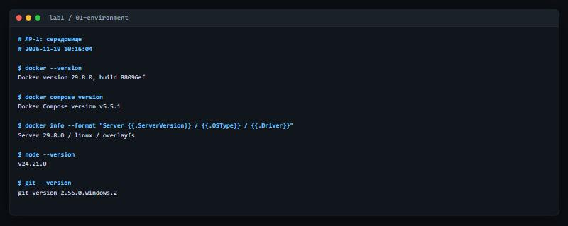
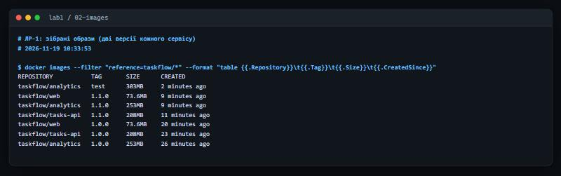
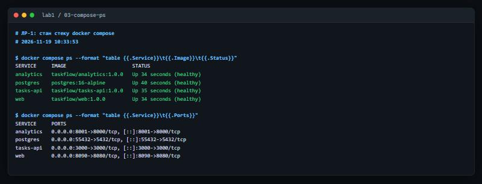
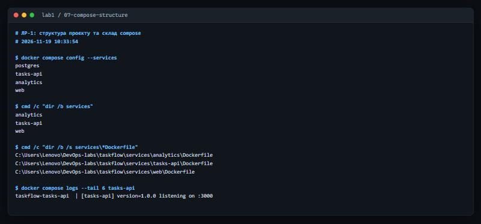
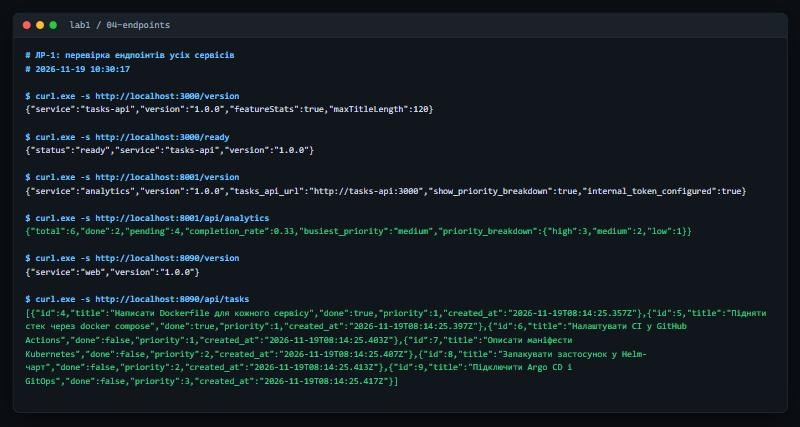
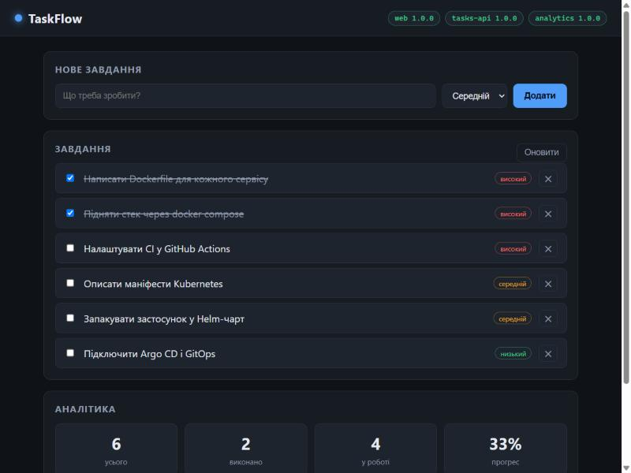
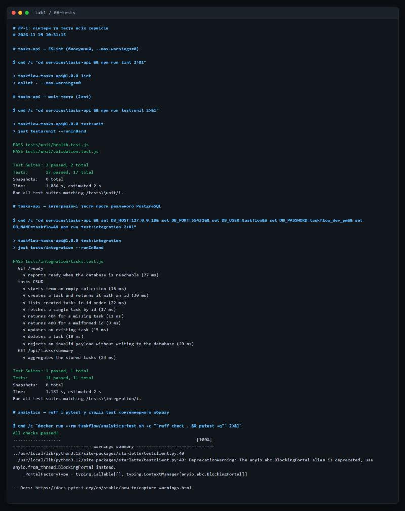

# Лабораторна робота №1

**Тема:** Віртуалізація та контейнеризація
**Предмет:** Технології DevOps
**Проєкт:** TaskFlow — мікросервісний трекер завдань
**Дата виконання:** 19.11.2026

---

## 1. Вибір проєкту

За основу взято власний проєкт **TaskFlow** — веб-застосунок для ведення списку
завдань. Проєкт свідомо спроєктований так, щоб задовольняти всі вимоги пункту 1
умови і бути придатним для подальших лабораторних.

| Вимога умови | Як виконано |
|---|---|
| a) будь-яка мова та технології | Node.js 20 (Express), Python 3.12 (FastAPI), nginx, PostgreSQL 16 |
| b) веб-застосунок, що взаємодіє з БД | `tasks-api` зберігає завдання в PostgreSQL; `web` — веб-інтерфейс до них |
| c) юніт- або інтеграційні тести | **17** юніт-тестів Jest, **11** інтеграційних Jest (проти реальної БД), **19** тестів pytest |
| d) кілька частин / мікросервіси | три власні сервіси (`tasks-api`, `analytics`, `web`) + інфраструктурний PostgreSQL |

### Архітектура

```
                    ┌──────────────────────────┐
   браузер  ───────▶│  web  (nginx :8080)      │
                    │  статика + reverse proxy │
                    └───────┬──────────┬───────┘
                            │          │
              /api/tasks    │          │   /api/analytics
                            ▼          ▼
         ┌──────────────────────┐   ┌─────────────────────────┐
         │ tasks-api  :3000     │◀──│ analytics  :8000        │
         │ Node.js 20 + Express │   │ Python 3.12 + FastAPI   │
         └──────────┬───────────┘   └─────────────────────────┘
                    │
                    ▼
         ┌──────────────────────┐
         │ postgres :5432       │
         │ PostgreSQL 16        │
         └──────────────────────┘
```

Кожен власний сервіс має три службові ендпоінти: `/health` (liveness),
`/ready` (readiness) і `/version` — остання знадобиться в ЛР-5 для доведення
того, що Argo CD справді розгорнув нову версію.

### Середовище виконання



---

## 2. Dockerfile для кожного сервісу

Для **кожної** частини проєкту написано окремий `Dockerfile`. Усі вони —
багатостадійні, з окремою стадією тестування і непривілейованим користувачем
у рантаймі.

| Сервіс | Файл | Базовий образ | Стадії |
|---|---|---|---|
| tasks-api | [`services/tasks-api/Dockerfile`](../services/tasks-api/Dockerfile) | `node:20-alpine` | `deps` → `test` → `runtime` |
| analytics | [`services/analytics/Dockerfile`](../services/analytics/Dockerfile) | `python:3.12-slim` | `deps` → `test` → `runtime` |
| web | [`services/web/Dockerfile`](../services/web/Dockerfile) | `nginx:1.27-alpine` | одна стадія |

### Рішення, прийняті у Dockerfile

**Багатостадійна збірка.** Стадія `deps` ставить лише продакшн-залежності й
віддає їх у рантайм через `COPY --from=deps`. Інструменти збірки та dev-залежності
у фінальний образ не потрапляють.

**Окрема стадія `test`.** Містить dev-залежності й виконує лінт і тести прямо
під час збірки:

```dockerfile
FROM node:20-alpine AS test
...
RUN npm run lint && npm run test:unit
```

Таку стадію можна зібрати окремо — це зручно й для CI в ЛР-2:

```bash
docker build --target test services/tasks-api
docker build --target test services/analytics
```

**Непривілейований користувач.** Контейнери не працюють від root:

```dockerfile
RUN addgroup -S app && adduser -S app -G app
USER app
```

**HEALTHCHECK.** Кожен образ сам повідомляє про свій стан — завдяки цьому
`docker compose ps` показує `(healthy)`, а не просто `Up`.

**ARG APP_VERSION.** Версія передається під час збірки й потрапляє у відповідь
`/version`. Саме так з одного коду збираються різні версії образу:

```bash
docker build --build-arg APP_VERSION=1.1.0 -t taskflow/web:1.1.0 services/web
```

**.dockerignore.** У кожному сервісі є свій `.dockerignore`, щоб `node_modules`,
`__pycache__`, `.git` і звіти про покриття не потрапляли в контекст збірки.

### Зібрані образи

Зібрано по дві версії кожного сервісу (`1.0.0` і `1.1.0`) — другу буде
використано для демонстрації оновлення та відкату в ЛР-3 і ЛР-5.



---

## 3. docker-compose

Файл [`docker-compose.yml`](../docker-compose.yml) піднімає **увесь** проєкт
разом із базою даних однією командою.

```bash
docker compose up -d --build
```

### Що саме в ньому зроблено

**Порядок запуску за станом здоров'я.** `tasks-api` стартує не «після» бази, а
лише коли база справді готова приймати з'єднання:

```yaml
depends_on:
  postgres:
    condition: service_healthy
```

**Іменований том для даних.** `pgdata` переживає `docker compose down`, тож
завдання не зникають між перезапусками.

**Окрема мережа `taskflow`.** Сервіси звертаються один до одного за іменами
(`postgres`, `tasks-api`, `analytics`), без прив'язки до IP.

**Усі параметри винесені у змінні.** Порти хоста, пароль БД і версія образу
задаються через `.env` (шаблон — [`.env.example`](../.env.example)); у файлі
compose прописані лише значення за замовчуванням.

**Нестандартні порти на хості.** На машині вже працюють локальний PostgreSQL 18
(порт 5432) і сторонній контейнерний стек, що займає 8000 і 8080. Тому назовні
проєкт опубліковано так:

| Сервіс | Порт у мережі Docker | Порт на хості |
|---|---|---|
| web | 8080 | **8090** |
| tasks-api | 3000 | 3000 |
| analytics | 8000 | **8001** |
| postgres | 5432 | **55432** |

### Стан стеку після запуску



Усі чотири контейнери у стані `Up (healthy)` — healthcheck кожного образу
відпрацював успішно.

### Склад проєкту і compose



---

## 4. Перевірка працездатності

### Відповіді сервісів



Видно, що:

- усі три сервіси віддають свою версію `1.0.0`;
- `tasks-api` у стані `ready` — отже, з'єднання з PostgreSQL встановлено;
- `analytics` справді ходить до `tasks-api` (`"tasks_api_url":"http://tasks-api:3000"`)
  і повертає агреговану статистику;
- `web` проксує запити до обох API — `curl http://localhost:8090/api/tasks`
  повертає дані з бази.

### Веб-інтерфейс



У правому верхньому куті — версії всіх трьох сервісів, отримані живими запитами
до `/version`. Дані в списку приїхали з PostgreSQL через `tasks-api`, блок
«Аналітика» — з Python-сервісу.

### Тести



| Перевірка | Результат |
|---|---|
| ESLint (`--max-warnings=0`) | без зауважень |
| Jest — юніт-тести | **17 passed** |
| Jest — інтеграційні тести (реальний PostgreSQL) | **11 passed** |
| ruff | `All checks passed!` |
| pytest | **19 passed** |

---

## 5. Система контролю версій

Проєкт ініціалізовано як git-репозиторій і залито на GitHub.

```bash
git init -b main
git add -A
git commit -m "feat: TaskFlow microservice project with Docker packaging (lab 1)"
gh repo create taskflow --public --source . --push
```

Посилання на репозиторій: див. розділ «Репозиторії» у
[docs/RUNBOOK.md](../docs/RUNBOOK.md).

---

## Висновки

У роботі створено мікросервісний застосунок із трьох власних сервісів і бази
даних, кожен сервіс упаковано в окремий контейнерний образ, а весь проєкт
піднімається однією командою `docker compose up -d`.

Що саме дала контейнеризація в цьому проєкті:

1. **Відтворюваність.** Node 20 і Python 3.12 зафіксовані в образах, тому
   застосунок не залежить від того, які версії стоять на машині (локально,
   наприклад, стоїть Node 24 і Python 3.14 — збірці це не заважає).
2. **Ізоляція від хоста.** На машині вже працював PostgreSQL 18 на порту 5432;
   контейнерна база спокійно живе поруч на 55432, не конфліктуючи з ним.
3. **Тести як частина збірки.** Стадія `test` у Dockerfile не дає зібрати
   образ із кодом, що не проходить лінт або тести.
4. **Готовність до наступних робіт.** Ті самі Dockerfile використовуються без
   змін у CI (ЛР-2), а зібрані образи — у Kubernetes (ЛР-3), Helm (ЛР-4) і
   Argo CD (ЛР-5).

### Команди для перевірки роботи

```bash
docker compose up -d --build     # підняти все
docker compose ps                # має бути 4 × Up (healthy)
curl http://localhost:3000/version
curl http://localhost:8001/api/analytics
start http://localhost:8090      # веб-інтерфейс
docker compose down              # зупинити
```
